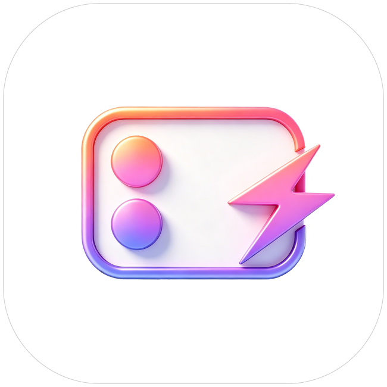

<p align="center">
  
</p>
<h1  align="center">MiBackscreen</h1>

<p  align="center">
  <a href="./README_EN.md">English</a> · <a href="https://github.com/chuan2033/MiBackscreen">项目主页</a>
</p>

<p  align="center">
 基于 Modern Xposed 的小米背屏模块。当前分支 `feat/18pro-max-rear-screen` 包含新版背屏中心、主题商店和负一屏应用卡适配。分支名及请求中使用的机型标识不代表实际设备支持范围。
</p>

<p  align="center">
  <a href="https://github.com/chuan2033/MiBackscreen/releases"></a>
 <a href="https://github.com/chuan2033/MiBackscreen/stargazers"></a>
 <a href="https://github.com/chuan2033/MiBackscreen/issues"></a>
  <a href="https://developer.android.com/"></a>
 <a href="https://github.com/LSPosed/LSPosed"></a>
</p>

## 功能

| 功能 | 默认 | 说明 |
| --- | --- | --- |
| 背屏电量环 | 关 | 沿摄像头轮廓显示电量，每 1% 更新；充电绿、低电红、其余白 |
| 18 Pro 功能 | 开 | AI 背屏入口、机型与下载适配、应用卡解锁、负一屏商店适配、AI 索引同步 |
| 禁用长按切换壁纸 | 开 | 长按不进编辑 |
| 定时切换背屏壁纸 | 关 | 每 1 / 5 / 15 分钟按列表循环；AOD 可见时计时 |
| 移除壁纸数量限制 | 开 | 解除主题商店 15 张限制 |
| 背屏应用卡 / 移除数量限制 | 开 / 开 | 上滑列表显示 MiBackscreen 卡片，点击开快捷面板 |
| 修复背屏壁纸应用 | 关 | 修复资源访问与应用状态同步 |
| 禁用背屏保护提示 | 关 | 拦截「先熄灭正屏」的提示 |
| 按应用禁用双击唤醒 | 关，名单为空 | 功能页选应用；关开关保留名单 |
| 背屏息屏时间 | 跟随系统 | 一直亮屏或 1 / 3 / 5 / 10 / 30 分钟后息屏，只作用于背屏 |
| 游戏时保持背屏常亮 | 关 | 横屏游戏时系统会关背屏，开启后保持常亮，增加耗电发热 |
| 定时关闭背屏 | 关 | 每天时间窗内黑屏或息屏，不被通知、双击点亮，到点恢复 |
| 配置备份 / 恢复 | — | 导出全部设置到存储根目录 `MiBackscreen-config.json`，可读回 |
| 人脸录入兼容 | 关 | AI 陪伴要求录入人脸时打开 |
| 主题商店模块入口 | 开 | 妙享背屏设置页显示入口 |

外观支持系统/浅色/深色、动态取色、普通/悬浮底栏、液态玻璃（后两者默认关）。功能页角标显示已开启数量（1–12），可在设置里隐藏。

电量环按 popsicle 的 976 × 596 校准，颜色优先读 SystemUI 电池资源；离开背屏桌面释放绘制层。18 Pro 总开关切换会请求重启背屏、主题商店和智能助理。

## 安装

- Android 16+（API 36），LSPosed 或兼容 Modern Xposed 的框架。
- Hook 依赖宿主类与方法签名，系统或宿主更新后需重新核验。实测机型：小米 17 Pro Max（popsicle / 2509FPN0BC），HyperOS 4。

启用模块并勾选 4 个作用域，重启手机：

| 作用域 | 用途 |
| --- | --- |
| `system` | 背屏保护提示、双击唤醒拦截、息屏时间、游戏保持亮、定时关闭 |
| `com.xiaomi.subscreencenter` | 长按、壁纸轮换、应用卡与快捷面板 |
| `com.android.thememanager` | 壁纸数量/应用、设置入口、AI 与人脸兼容 |
| `com.miui.personalassistant` | 负一屏应用卡商店适配 |

「重启作用域」含系统、背屏、主题商店和智能助理；勾选系统会整机重启。主页「已激活」只表示服务已连接，不证明 Hook 成功。

若提示 `vendor.display.builtin_presentation=0`，检查隐藏背屏/防屏幕共享类模块。

## 反馈

复现后立即在「主页 → 日志」生成反馈 ZIP（需 root），经检查后通过 [Issues](https://github.com/chuan2033/MiBackscreen/issues) 附上复现步骤与版本。包内含配置、日志与设备信息，分享前先看一遍。

## 构建

JDK 21、Android SDK 37、Build Tools 37.0.0、Gradle 9.6.0（Wrapper）。配置 `JAVA_HOME` 与 `local.properties` 的 `sdk.dir`：

```powershell
.\gradlew.bat :app:testDebugUnitTest :app:assembleDebug :app:lintDebug --offline --console=plain
.\gradlew.bat :app:assembleRelease --offline --console=plain
```

无依赖缓存时去掉 `--offline`。Release 签名从 `local.properties` 或环境变量读 `RELEASE_STORE_FILE` / `RELEASE_STORE_PASSWORD` / `RELEASE_KEY_PASSWORD`（可选 `RELEASE_KEY_ALIAS`，默认 `hyperbackscreen`），未配置则输出未签名包。覆盖安装须同证书。

## 许可证

[GPL-3.0](LICENSE)。不同固件可能存在兼容问题，请按已验证范围使用。

| 项目 | 许可证 | 用途 |
| --- | --- | --- |
| [Miuix](https://github.com/compose-miuix-ui/miuix) | Apache-2.0 | Compose UI、导航及模糊 |
| [AndroidX](https://developer.android.com/jetpack/androidx) | Apache-2.0 | Activity、Compose、生命周期 |
| [Modern Xposed](https://central.sonatype.com/artifact/io.github.libxposed/api/102.0.0) | Apache-2.0 | Hook API |
| [AndroidLiquidGlass](https://github.com/Kyant0/AndroidLiquidGlass) | Apache-2.0 | 本地玻璃效果来源 |
| [KernelSU](https://github.com/tiann/KernelSU) | GPL-3.0 | 悬浮底栏实现参考 |
